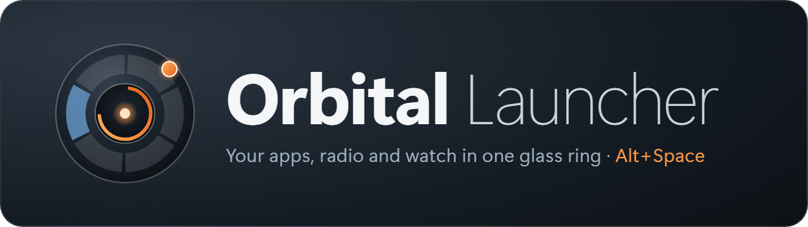
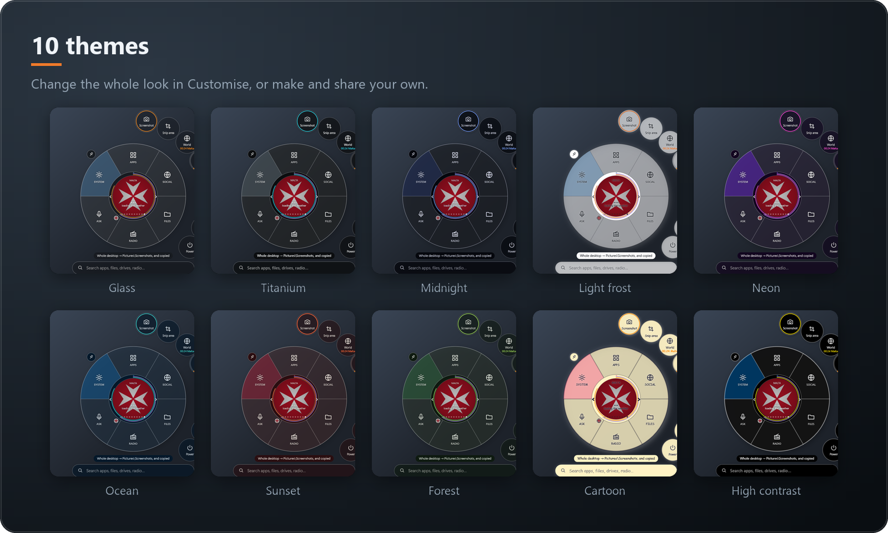
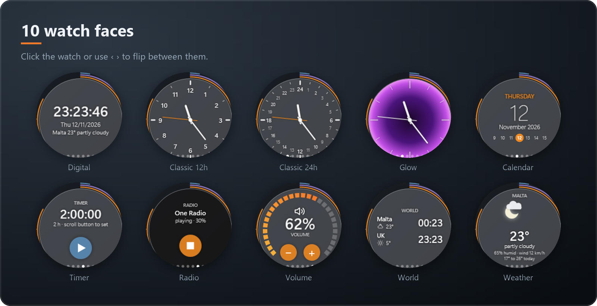
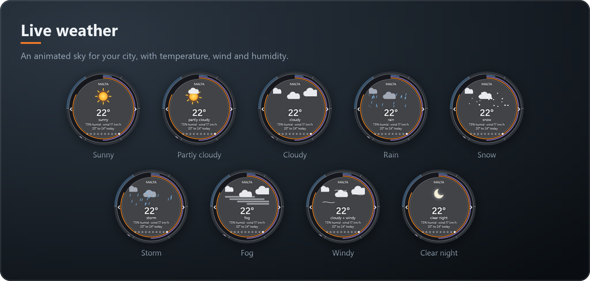
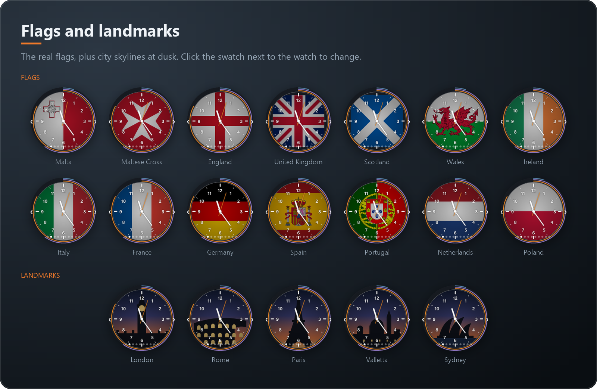
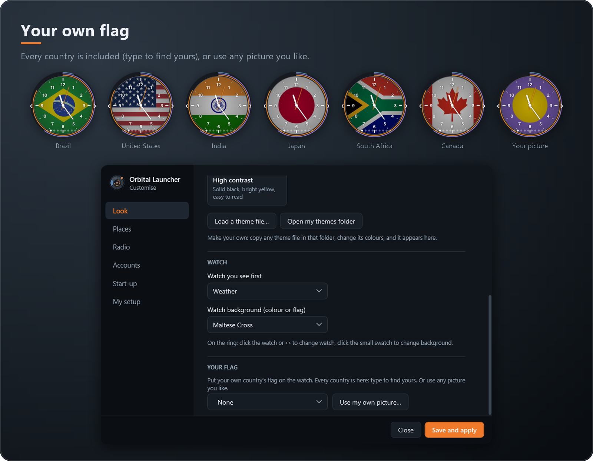
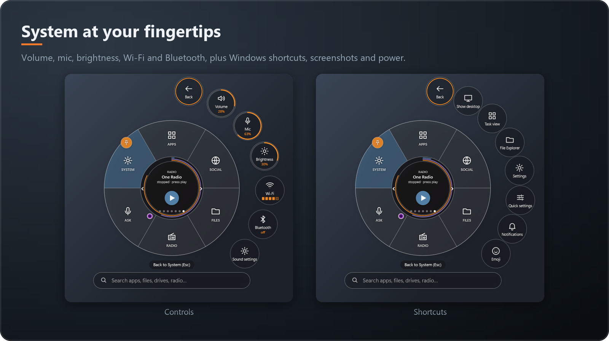
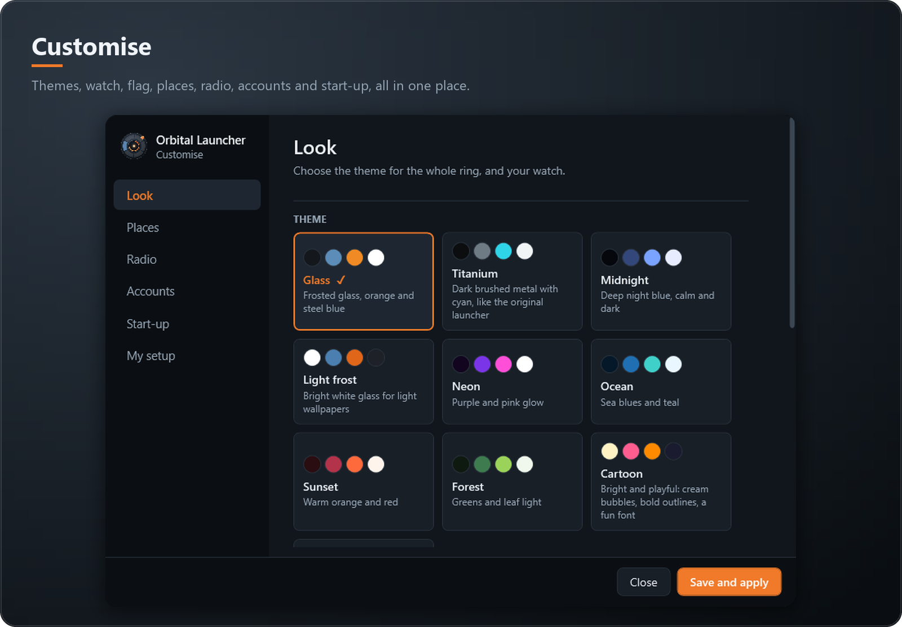

<p align="center">
  
</p>

<p align="center">
  <b>A frosted-glass ring launcher for Windows 10 and 11.</b><br>
  Press <kbd>Alt</kbd>+<kbd>Space</kbd> anywhere: your apps, files, radio, weather and system controls in one ring at your mouse.
</p>

<p align="center">
  <a href="https://github.com/debattistacliff-commits/Orbital-Launcher/releases/latest"></a>
</p>

<p align="center">
  
  
  
  <a href="https://buymeacoffee.com/debattistaj"></a>
</p>

<p align="center">
  <a href="#install">Install</a> ·
  <a href="#tour">Tour</a> ·
  <a href="#how-to-use-it">How to use it</a> ·
  <a href="#customise">Customise</a> ·
  <a href="#privacy">Privacy</a> ·
  <a href="#support">Support</a>
</p>

---

## Highlights

| Feature | What it does |
| --- | --- |
| 🪐 **One ring for everything** | Apps, social apps, files, radio and system controls, opened with <kbd>Alt</kbd>+<kbd>Space</kbd>, the desktop right-click menu or the tray. |
| 🔎 **Search as you type** | Apps, files on every drive, radio stations, places and a work timer. |
| 📻 **World radio** | Stations by country, favourites and search, with lights that move to the music. |
| ⌚ **10 watch faces** | Digital, classic 12h and 24h, calendar, timer, world times and an animated weather sky. |
| 🏳️ **Your flag** | The real flags of Malta, Wales, Portugal, Spain and more, or **any country's flag**, or your own picture. |
| 🎨 **10 themes** | From frosted glass to Cartoon and High contrast, or make and share your own. |
| 🟢 **Knows what's open** | A green dot shows open apps: click to switch, click again or press × to close. |
| 🔒 **Private** | No account, no tracking, no adverts. |

## Install

1. **[Download Orbital Launcher](https://github.com/debattistacliff-commits/Orbital-Launcher/releases/latest)**: on that page, click the **Setup.zip** file.
2. Open your Downloads folder, right-click the ZIP and choose **Extract All…**
3. Open the extracted folder and double-click **Install Orbital Launcher.bat**.

That's it: nothing else to download, and no admin rights needed. **Orbital Launcher** appears on your desktop and in the Start menu, and starts straight away. The first time, the Customise window opens so you can make the ring yours.

> [!TIP]
> If Windows shows *"Windows protected your PC"*, click **More info** → **Run anyway**. Windows shows this for any downloaded program it doesn't know yet.

**Update:** download the new version and run its installer again; your settings are kept.
**Remove:** Settings → Apps → Installed apps → Orbital Launcher → Uninstall.

## Tour

<p align="center"></p>
<p align="center"></p>
<p align="center"></p>
<p align="center"></p>
<p align="center"></p>
<p align="center"></p>

## How to use it

### Open the ring

| How | What happens |
| --- | --- |
| <kbd>Alt</kbd>+<kbd>Space</kbd> | Opens and closes the ring at your mouse. If another app already uses it (for example PowerToys Run), it's <kbd>Ctrl</kbd>+<kbd>Alt</kbd>+<kbd>Space</kbd>; the tray tooltip tells you which. |
| Desktop right-click | *Show more options* → **Orbital Launcher**. |
| Tray icon | Click the Orbital Launcher icon next to the clock. |
| Move or pin it | Drag the watch to move the ring. Click the **pin** just outside the ring to keep it open in that spot. |

### Sections

| Section | What you get |
| --- | --- |
| **Apps** | Your pinned apps (up to 14, with a *More* page). Right-click any app to pin or unpin it. Drag a shortcut onto the ring, or copy it and press <kbd>Ctrl</kbd>+<kbd>V</kbd>, to pin your own. |
| **Social** | Facebook, Instagram, TikTok, WhatsApp, YouTube, Telegram, Discord and more, from the Store, Edge, Chrome or as programs, plus your browser profiles. |
| **Files** | Desktop, Documents, Downloads, Pictures, Music, Videos, This PC. |
| **Radio** | Stations from your country and any others you choose, favourites and recent stations. Right-click a station to save it. |
| **System** | Screenshot, snip, screen recording, volume, mic, brightness, Wi-Fi, Bluetooth, Windows shortcuts, timer, world times and power (restart and shut down need two clicks). |

### Search

Just start typing when the ring is open. <kbd>Enter</kbd> opens the top result, <kbd>↑</kbd> <kbd>↓</kbd> move, <kbd>Esc</kbd> clears.

| Type | To find |
| --- | --- |
| `notepad` | Apps, folders, actions and saved stations |
| `f report` | Files (press **Search all drives** for a full scan; right-click a result to show its folder) |
| `r jazz` | Radio stations worldwide |
| `t 45m` · `t 2h` | A work timer that rings when time is up |
| `w rome` | The time and weather anywhere |

### The watch

Click the watch, or use **‹ ›**, to flip between faces. Click the small swatch beside it (or right-click the watch) for the next colour, flag or landmark.

## Customise

Right-click the tray icon → **Customise…** (or *System → More → Customise*).

<p align="center"></p>

| Page | What you set |
| --- | --- |
| **Look** | Theme, the watch you see first, its background, and **Your flag**: pick any country (type to find it) or **Use my own picture…** |
| **Places** | Cities for the World and Weather watches. |
| **Radio** | Which countries' stations to list. |
| **Accounts** | Which Chrome and Edge profiles appear in Social. |
| **Start-up** | Hotkey, start with Windows, and the desktop right-click entry. |
| **My setup** | Save your whole setup to a file, to move it to another PC or share it. |

Press **Save and apply** to see your changes.

## Privacy

- No account, no tracking, no adverts. Your settings stay on your PC (`%LOCALAPPDATA%\DesktopOrbit`).
- Your apps, files and profiles are read from Windows on your PC and never leave it.
- Radio comes from the free community directory [Radio Browser](https://www.radio-browser.info/), and weather from [Open-Meteo](https://open-meteo.com/). Only the positions of your chosen places are sent.
- Orbital Launcher never sees or stores passwords.

## Support

Orbital Launcher is free. If you enjoy it and want to say thanks, you can [buy me a coffee](https://buymeacoffee.com/debattistaj) ☕. It's completely voluntary.

<details>
<summary><b>For developers</b></summary>

<br>

**Build from source:** green **Code** button → **Download ZIP**, extract it, and double-click **Install.bat**. It builds the app with the .NET 10 SDK (and offers to install it if it's missing). **Uninstall.bat** removes it.

```text
Ring/              The ring window, watch faces, open-app tracking, drag-and-drop pins
ShellIntegration/  App catalogue, icons, radio, audio, brightness, weather, settings, self-test
Customise/         The Customise window
release/           The one-click installer in the download
scripts/           Install, uninstall and package-release
```

- `dotnet build` builds it; `scripts\package-release.ps1` makes the Setup.zip.
- `OrbitalLauncher.exe --selftest` checks everything on your PC and writes `%LOCALAPPDATA%\DesktopOrbit\selftest.txt`. It never restarts or shuts down the PC.
- What's next: [docs/ROADMAP.md](docs/ROADMAP.md).

</details>

## Credits

- Country flags: [flag-icons](https://github.com/lipis/flag-icons) by Panayiotis Lipiridis (MIT License).
- Wales, Portugal, Spain and Malta flags: official flags from [Wikimedia Commons](https://commons.wikimedia.org/) (public domain).
- Radio: [Radio Browser](https://www.radio-browser.info/). Weather: [Open-Meteo](https://open-meteo.com/).

## Licence

Created and maintained by [@debattistacliff-commits](https://github.com/debattistacliff-commits).

**© 2026 debattistacliff-commits. All rights reserved.** You're welcome to download and use Orbital Launcher for free. Copying, changing, re-uploading or selling it, or using its name or logo, is not allowed without permission. See [LICENSE](LICENSE).
